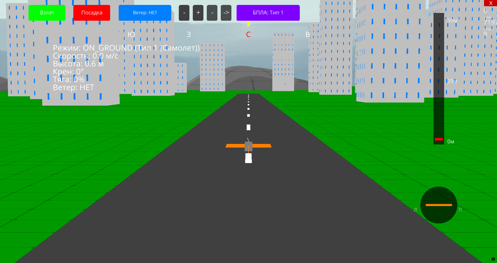

# Полётный симулятор для беспилотных летательных аппаратов (БПЛА)

Прототип реалистичного полётного симулятора БПЛА, разработанный в рамках соревнования от Департамента информатизации и Федерации спортивного программирования Тюменской области.

Проект представляет собой инструмент для инженеров и потенциальных заказчиков, позволяющий оценить лётные характеристики и поведение различных моделей дронов в кастомных погодных условиях и на сложном рельефе местности без риска повреждения реальной техники.

---

## Интерфейс программы


---

## Ключевые возможности и функционал

### 1. Физическая модель и среда
* **Динамика полёта:** Реалистичный расчёт физики движений с учётом гравитации, тяги двигателей, массы аппарата и сопротивления воздуха.
* **Погодные условия:** Симуляция воздействия ветра (скорость и направление) на устойчивость БПЛА.
* **Цифровой профиль:** Поддержка нескольких конфигураций параметров беспилотника (габариты, вес, лимиты тяги).

### 2. Визуализация и телеметрия
* **Камеры:** Поддержка вида от 3-го лица.
* **Телеметрия в реальном времени:** Вывод ключевых показателей на приборную панель: высота, скорость, углы ориентации.

---

## Вариант 1. Быстрый запуск готового прототипа (.exe)

Для запуска скомпилированной версии не требуется установленный интерпретатор Python:

1. Скачайте файлы **`BPLA.exe`** и **`_internal.zip`** в одну общую директорию.
2. Полностью распакуйте архив `_internal.zip` (внутри будет папка `_internal`) в эту же папку.
   > ⚠️ **Важно:** Папка `_internal` и исполняемый файл `BPLA.exe` должны лежать строго в одном каталоге на одном уровне, иначе приложение выдаст ошибку.
3. Запустите файл **`BPLA.exe`**.

---

## Вариант 2. Запуск из исходного кода (Python)

Для проверки структуры кода, архитектурных решений и запуска скриптов напрямую выполните следующие шаги:

### Инструкция по развёртыванию:

1. **Перейдите в корень проекта** через терминал или командную строку:
   ```bash
   cd путь_к_папке_проекта
   ```

2. **Инициализируйте изолированное окружение** (рекомендуется):
   * **Windows:**
     ```bash
     python -m venv venv
     venv\Scripts\activate
     ```
   * **macOS / Linux:**
     ```bash
     python3 -m venv venv
     source venv/bin/activate
     ```

3. **Установите все необходимые зависимости** и библиотеки:
   ```bash
   pip install -r requirements.txt
   ```

4. **Запустите симулятор:**
   ```bash
   python main.py
   ```

---

## Технологический стек
* **Язык программирования:** Python 3
* **Основные библиотеки:** Ursina, Panda3D
